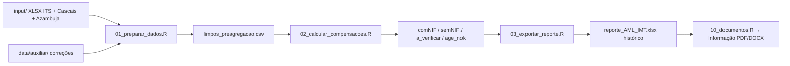

# TML — Compensações do Passe Gratuito para Jovens (Navegante)

Pipeline em **R** para o cálculo mensal da compensação financeira dos passes gratuitos para jovens (sub 23 anos) na Área Metropolitana de Lisboa (AML), a reportar ao **IMT**.

Aplica a metodologia da **Portaria n.º 7-A/2024** (alterada pela Portaria 307-A/2024 e pela Portaria 287/2026/1):

- **Leitura e limpeza** dos dados de bilhética (ITS), Cascais e complemento Azambuja
- **Correções** de NIF, datas de nascimento e repescagem de NIFs em falta
- **Agregação por titular**: por NIF (**comNIF**) ou por documento / cartão (**semNIF**)
- **Compensação**: 5 % do título de referência por validação (< 20 validações); título completo a partir de 20 validações
- **Listas de controlo**: registos a verificar, idades incompatíveis e documentos de identificação irregulares
- **Reporte Excel (xlsx)** no template oficial AML/IMT (comNIF, semNIF e RESUMO)
- **Histórico** mensal atualizado automaticamente (`compensacao_pj_anteriores.csv`)
- **Informação 1 (PDF/DOCX)** com os resultados do mês

> [!NOTE]
> Nesta versão, só são suportados os meses **a partir de julho de 2026** (formato XLSX com `doc_type`/`doc_number` e template v2). Os meses anteriores (maio, junho) tinham requisitos diferentes e já não são mantidos.

---

## 🗓️ Como Preparar um Novo Mês (ex: Agosto de 2026)

Seguir os passos **por esta ordem**.

### 1. Criar a pasta de dados do mês

Cria `data/2026_08_agosto/input/` (a pasta `data/` está no `.gitignore`). A pasta `output/` é criada automaticamente.

### 2. Colocar os ficheiros de input

```
data/2026_08_agosto/input/
├── 202608_PasseJovem_ValidaçõesLimpas.xlsx   ← ITS (folha 1: validações; folha "Azambuja": complemento)
└── TML_agosto2026.xlsx                          ← Cascais (Viver Cascais)
```


| Ficheiro                 | Origem  | Notas                                                                                                                                                                                                                                          |
| -------------------------- | --------- | ------------------------------------------------------------------------------------------------------------------------------------------------------------------------------------------------------------------------------------------------ |
| `*PasseJovem*.xlsx`      | ITS     | O nome tem de conter`PasseJovem`. Colunas: `YEAR_DIST, MONTH_DIST, CARD_SERIAL_NUMBER, AGE, FISCAL_NUMBER, TICKET_OPERATOR_CODE, TICKET_CODE, TICKET_NAME, PRICE, PRICE_TICKET_BASE, COUNT_VAL, BIRTH_DATE, ID_DOC_NUMBER, ID_DOC_NUMBER_DESC` |
| `TML_<mes><ano>.xlsx`    | Cascais | Preço vem a 0; o pipeline fixa`PRECO_CASCAIS = 20` e operador `21`                                                                                                                                                                            |
| `*Complemento_Azambuja*` | ITS     | Opcional. Se não existir em ficheiro separado, é lido da folha com "Azambuja" no nome do XLSX principal                                                                                                                                      |


### 3. Atualizar os ficheiros auxiliares (`data/auxiliar/`)


| Ficheiro                        | Conteúdo                                                                      | Quando atualizar               |
| --------------------------------- | -------------------------------------------------------------------------------- | -------------------------------- |
| `nif_repescagem2024.csv`        | `card_serial_number → fiscal_number` (preenche NIFs em falta)                 | Quando surgem NIFs recuperados |
| `nif_correct.csv`               | `card_serial_number; birth_date; fiscal_number` (NIFs/datas errados)           | Quando se detetam erros        |
| `data_nascimento_correct.csv`   | `card_serial_number; dn_errada; fiscal_number; dn_corrigida`                   | Idem                           |
| `id_exception.csv`              | `doc_type; doc_number; motivo` — documentos a **agrupar** apesar de anomalias | Casos validados manualmente    |
| `compensacao_pj_anteriores.csv` | Histórico mensal                                                              | Atualizado automaticamente     |

### 4. Verificar o template do reporte

O reporte é uma cópia do template `Exemplos/Template_PASSE GRATUITO JOVEM - REPORTE - CIM_AT para IMT (Mensal) - 2026 - V2.xlsx`. Não o alteres.

### 5. Parâmetros dos documentos (`code/doc_params.R`)

Editar `ANO`, `MES`, `mes_nome`, `meses_pagos_ano_atual`, os números de referência (`numero_informacao1`, `numero_oficio1`, …) e a `data_documento`.

### 6. Ambiente R

Os pacotes R necessários são instalados automaticamente por `code/00_config.R`.
Para os documentos é necessário o **Quarto CLI**.

---

## 🚀 Como Executar

A partir da raiz do projeto:

```powershell
# Um mês
Rscript code/99_run_pipeline.R 2026 8

# Vários meses
Rscript code/99_run_pipeline.R 2026 8 9

# Todos os meses de 2026 em data/
Rscript code/99_run_pipeline.R 2026
```

No R / RStudio:

```r
source("code/99_run_pipeline.R")
run_pipeline(ano = 2026, meses = 8)
```

Cada passo pode ser corrido isoladamente (`preparar_dados()`, `calcular_compensacoes()`, `exportar_reporte()`). O processamento demora 10 a 60 s por mês (~450 000 registos, via `data.table`). Se um mês falhar, o erro é registado e o pipeline segue para o seguinte.

### Pipeline



---

## 📄 Como Gerar os Documentos

```powershell
Rscript code/10_documentos.R            # usa ANO/MES de doc_params.R
Rscript code/10_documentos.R 2026 8     # mês específico
```

Renderiza `code/informacao1.qmd` para PDF (Typst) e DOCX (controlado por `RENDER_PDF` / `RENDER_DOCX` em `doc_params.R`) e copia-os para `output/`. Para regenerar os estilos Word: `Rscript code/templates/build_reference_doc.R` (fecha o Word antes).

---

## 📊 Ficheiros de Saída

Em `data/AAAA_MM_mes/output/`:


| Ficheiro                                  | Descrição                                                                                  |
| ------------------------------------------- | ---------------------------------------------------------------------------------------------- |
| **`AAAA_MM_reporte_AML_IMT.xlsx`**        | **Reporte oficial ao IMT**: folhas ComNIF, SemNIF e RESUMO                                   |
| `AAAA_MM_comNIF.csv`                      | Compensação por NIF                                                                        |
| `AAAA_MM_semNIF.csv`                      | Compensação por documento (ou cartão) para quem não tem NIF                              |
| `AAAA_MM_a_verificar.csv`                 | Registos suspeitos para revisão manual (exceção ID, datas distintas, sem NIF, idade > 23) |
| `AAAA_MM_age_nok.csv`                     | Registos excluídos por idade incompatível (3 ou ≥ 25 anos)                                |
| `AAAA_MM_documentos_estranhos_semNIF.csv` | Documentos semNIF anómalos (zeros, noves, repetidos, < 6 dígitos, partilhados…)           |
| `AAAA_MM_limpos_preagregacao.csv`         | Dados limpos antes da agregação (intermédio)                                              |
| `AAAA_MM_complemento_azambuja.csv`        | Complemento Azambuja normalizado                                                             |
| `AAAA_MM_registos_brutos.rds`             | Nº de registos brutos (para o histórico)                                                   |
| `AAAA_MM_informacao1.pdf/.docx`           | Informação 1                                                                               |

---

## 🏷️ Fecho do Mês

Depois de validar o reporte e emitir os documentos, faz commit do código e dos parâmetros e cria uma tag:

```bash
git add code/ README.md procedure.md
git commit -m "feat(fecho): fecho de contas Passe Jovem agosto 2026"
git tag -a run-2026-08-agosto -m "Passe Jovem agosto 2026"
git push origin main --tags
```

---

## 📁 Estrutura do Repositório

```
PasseJovem/
├── code/
│   ├── 00_config.R                  # Constantes de negócio, caminhos, leitura e utilitários
│   ├── 01_preparar_dados.R          # Leitura, combinação, limpeza e correções manuais
│   ├── 02_calcular_compensacoes.R   # Agregação (comNIF/semNIF), Azambuja, compensação, controlos
│   ├── 03_exportar_reporte.R        # Preenche o template Excel AML/IMT e atualiza o histórico
│   ├── 10_documentos.R              # Renderiza a Informação (Quarto → Typst/DOCX)
│   ├── 99_run_pipeline.R            # Orquestrador (01 → 02 → 03)
│   ├── doc_params.R                 # Parâmetros de emissão mensais
│   ├── informacao1.qmd              # Informação 1
│   ├── utils_tables.R / utils_extenso.R
│   └── templates/                   # Estilos Typst/Word, papel timbrado, logo
├── data/                            # (gitignored)
│   ├── AAAA_MM_mes/{input,output}/
│   └── auxiliar/                    # Correções, exceções e histórico
├── documents/                       # Portarias (e procedimento antigo)
├── Exemplos/                        # Template Excel e exemplos de documentos (gitignored)
├── tests/                           # Testes (gitignored)
├── procedure.md                     # Metodologia e exceções
└── README.md
```

---

## 📖 Documentação Metodológica

Regras, fórmulas, exceções e casos especiais: 👉 **[`procedure.md`](procedure.md)**
